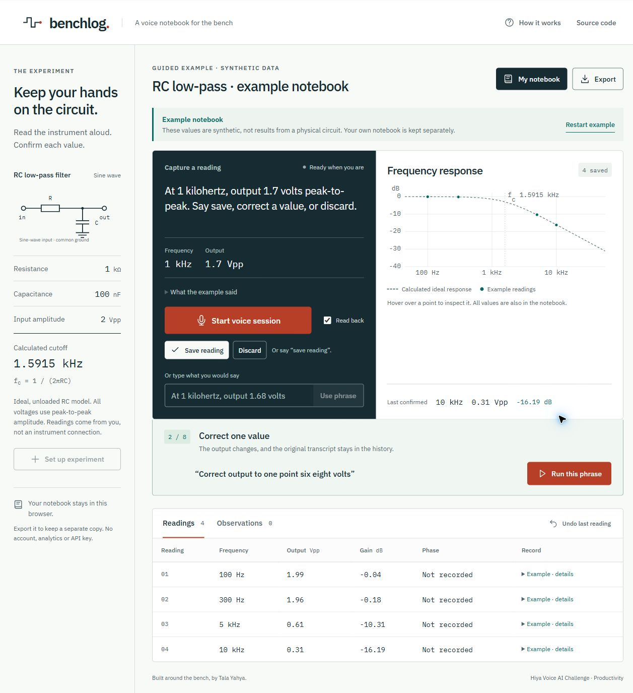

# Benchlog

A voice notebook for the electronics bench. Say a reading while holding your probes, correct what was heard, and confirm it before it enters the experiment record.

Built for the **Hiya Voice AI Challenge, Productivity track**. The initial workflow is a sine-wave frequency sweep through an RC low-pass filter. Benchlog records values read by a person; it does not connect to or operate lab instruments.

- Repository: [github.com/talayahya/Benchlog](https://github.com/talayahya/Benchlog/)
- Live demo: [talayahya.github.io/Benchlog](https://talayahya.github.io/Benchlog/)
- [One-page project explanation](docs/submission.md)
- [AI assistance disclosure](ai.md)
- [Research and design decisions](docs/research.md)
- [Plain-language review guide](docs/review-guide.md)
- [Verification record and limits](docs/verification.md)



## Run locally

Use **Node.js 22.12 or newer** and npm. From the repository directory:

```sh
npm ci
npm run dev
```

Open the localhost address printed by Vite. No API key, paid account or backend service is required. Dependencies need an internet connection during installation. Microphone access requires a secure context, such as HTTPS or localhost.

To check the code and preview the production build:

```sh
npm test
npm run build
npm run preview
```

`npm run check` runs TypeScript checks without making a production bundle. `npm run test:watch` keeps tests running during development.

## Try the complete workflow

1. Choose **Try example** for an isolated notebook containing explicitly labelled synthetic readings. The guided phrases demonstrate capture, correction, confirmation and handling a missing unit. Your own notebook is kept separately.
2. Return to **My notebook**. The starting setup is **1 kΩ, 100 nF and 2 Vpp**. Change these with **Set up experiment** before collecting data. Keep the input amplitude fixed during this notebook.
3. Choose **Start voice session**, select a speech mode, then allow microphone access. Wait until the app says it is listening.
4. Say **“At one kilohertz, output one point seven volts.”** The reading is proposed, not yet saved. Voltages use the experiment's peak-to-peak convention, which the app reads back.
5. Say **“Correct output to one point six eight volts.”** Check the new value, then say **“Save reading.”** The confirmed reading enters the table and plot.
6. Say **“Note: the trace looks noisy.”** Notes are stored separately from numerical measurements.
7. Use **Export** to download a CSV, Markdown report or JSON record. Stop the voice session when finished.

You can use **Or type what you would say** throughout. This exercises the same command interpreter without running speech recognition. It is also a fallback when a microphone or recognition service is unavailable.

### Test actual speech recognition without a microphone

Open **How it works**, then choose **Transcribe the sample on this device**. The app feeds [`public/examples/reading.wav`](public/examples/reading.wav), a synthetic Windows text-to-speech recording, through the actual local Whisper model. It opens an isolated example notebook, downloads the model if necessary and presents the resulting transcript as a pending reading. This is real model inference on synthetic audio, rather than a prerecorded transcript substituted for recognition.

In a desktop Edge check, Whisper returned **“At 1 kilohertz, output 1.7 volts.”**, which became a pending **1000 Hz / 1.7 Vpp** reading. The guided correction to **1.68 Vpp** and subsequent confirmation added it to the notebook and plot. This checks one audio fixture, not live microphone accuracy or general recognition performance. See the [verification record](docs/verification.md).

## Supported commands

| Purpose                                          | Example                                               |
| ------------------------------------------------ | ----------------------------------------------------- |
| Propose a measurement                            | `At one kilohertz, output one point six eight volts`  |
| Use SI symbols                                   | `At 500 Hz, output 1900 mV`                           |
| Include phase                                    | `At 1000 Hz, output 1.68 Vpp, phase minus 32 degrees` |
| Correct a pending value                          | `Correct output to 1.6 volts`                         |
| Complete a partial reading                       | `Frequency two kilohertz`                             |
| Save a complete pending reading                  | `Save reading`                                        |
| Discard an unconfirmed reading                   | `Discard reading`                                     |
| Bring the last saved reading back for correction | `Undo last reading`                                   |
| Hear the current or last saved reading           | `Repeat last reading`                                 |
| Add an observation                               | `Note: the trace looks noisy`                         |
| Summarise saved records                          | `Summarise the session`                               |
| Suggest a point from the RC model                | `Suggest next frequency`                              |
| Get command help                                 | `Help`                                                |

The interpreter supports bounded English commands, not unrestricted conversation. Numerical fields need units. It distinguishes `mHz` from `MHz`, rejects RMS and peak-only readings, and does not guess a missing unit. A changed input amplitude must be made through experiment setup rather than silently mixed into the current sweep.

Once a notebook contains readings or notes, changing its setup starts a **new notebook**. Export the current one first if you want to keep it. This prevents existing gains being reinterpreted with different component or input values.

## Speech modes

| Mode              | What happens                                                                                                         | Main limitation                                                                                        |
| ----------------- | -------------------------------------------------------------------------------------------------------------------- | ------------------------------------------------------------------------------------------------------ |
| Browser speech    | A compatible browser converts speech to text and supplies results to Benchlog.                                       | Availability varies. The browser may send audio to its speech provider and usually needs a connection. |
| On-device Whisper | `onnx-community/whisper-tiny.en` runs through Transformers.js, with quantised `q8` weights and WASM in a Web Worker. | Model/runtime resources download on first use; processing time depends on the device. English only.    |
| Typed phrase      | The entered text goes directly to the same interpreter.                                                              | No speech recognition is performed.                                                                    |

For local voice, pause for roughly **1.2 seconds** after a phrase. Simple audio-level detection divides recordings into turns; it is not a sophisticated speaker or noise detector. Benchlog pauses recognition while reading a response back. Speech spoken over that reply may need to be repeated afterwards.

Local mode selects an English speech-synthesis voice that the browser reports as local (`localService === true`). If no local English voice is available, it keeps the reply on screen and continues without spoken read-back. Browser-speech mode uses the browser/operating system's available voice facilities and does not make the same local-only guarantee.

The **How it works** dialog also accepts an audio clip for local transcription. It must be a format the browser can decode, **0.1–30 seconds** long and no larger than **10 MB**. The first use downloads the model. Download size and inference latency have not been benchmarked, so no fixed figures are promised.

## Architecture

```text
Microphone / local audio file
             |
       AI speech recognition
             |
         Transcript                 Typed phrase
             |                           |
             +------------+--------------+
                          |
             Deterministic command engine
                          |
                Pending numeric reading
                          |
                 Explicit confirmation
                          |
          Saved notebook + RC plot + exports
```

Speech recognition uses pretrained AI. Parsing, validation, confirmations, history, calculations and exports use conventional TypeScript. There is no general-purpose LLM deciding what a measurement should be.

| File                                | Responsibility                                                                       |
| ----------------------------------- | ------------------------------------------------------------------------------------ |
| `src/engine.ts`                     | Command interpretation, unit validation, notebook transitions, RC maths and exports. |
| `src/voice.ts`                      | Browser recognition lifecycle and spoken read-back.                                  |
| `src/localVoice.ts`                 | Microphone capture and silence-delimited local speech turns.                         |
| `src/localSpeech.ts`                | Clip validation, decoding, mono 16kHz conversion and worker requests.                |
| `src/whisper.worker.ts`             | Local speech model download and inference.                                           |
| `src/storage.ts`                    | Versioned browser storage and downloadable files.                                    |
| `src/App.tsx`                       | Application state and interaction.                                                   |
| `src/Plot.tsx`, `src/Schematic.tsx` | The response plot and circuit diagram.                                               |
| `tests/`                            | Automated checks of the implemented behaviour.                                       |

## Model assumptions

The expected response is for an ideal, unloaded, first-order RC low-pass filter, with output measured across the capacitor and a sine-wave input:

```text
cutoff frequency = 1 / (2πRC)
expected gain dB = -10 × log10(1 + (frequency / cutoff)²)
recorded gain dB = 20 × log10(output Vpp / configured input Vpp)
```

With the defaults, the calculated cutoff is approximately **1.59 kHz**. The expected curve and confirmed readings remain distinct. Probe loading, source impedance, component tolerances and instrument errors are not included. A suggested next frequency comes from this model, not an analysis of an instrument waveform. Phase can be recorded as an additional value; the current response chart focuses on amplitude gain.

## Data and privacy

- Benchlog has no account system, analytics or application database.
- Your notebook is stored in this browser's local storage. Clearing browser data removes it. Export a separate copy before changing devices or starting a new experiment.
- The synthetic example uses separate application state and does not replace the personal notebook.
- Benchlog does not persist audio recordings. Confirmed transcripts, corrections and notes remain in the local record. JSON exports contain the full session, including any pending reading; CSV and Markdown export confirmed measurements.
- Browser speech may send audio to the browser's chosen provider. This is disclosed before activation.
- Local Whisper processes captured audio on the device. Model/runtime downloads contact their hosting providers. The app fonts are bundled locally.
- Spoken read-back uses the browser's speech-synthesis facilities. Local mode explicitly selects a browser-reported local English voice or falls back to text; browser-speech mode depends on the browser/operating system's available voices.

## Verification and limits

The tests exercise the command engine and voice lifecycle, including parsing, validation, correction, confirmation, export behaviour and stale-callback handling. All **91 tests passed** in the full-suite check on 18 November 2026; run `npm test` for the current result. A successful build or mocked voice test does not establish real microphone accuracy.

The localhost production build's local Whisper path was exercised with the bundled synthetic speech fixture in desktop Microsoft Edge. The complete eight-step guided workflow produced six readings and one note. The downloaded CSV retained the original 1.7 Vpp phrase and its correction to 1.68 Vpp. A 390 × 844 browser viewport had no horizontal page overflow; this was an emulated viewport, not a physical mobile-device test. Live microphone lifecycle behaviour is covered with mocks; there has not been a live user microphone trial or a broad browser/device test. The distinction is recorded in [verification.md](docs/verification.md).

This prototype has no completed lab user study, measured time-saving claim or benchmark across accents, noise conditions and devices. It does not check electrical safety or control equipment. Its history is inspectable local provenance, not an immutable audit system. Recognition can be wrong; review each proposed reading.

Useful next work is to test the workflow with students at the bench, measure errors and interruptions against a spreadsheet baseline, and improve recovery where recognition or phrasing fails. More detail is in [research.md](docs/research.md) and the [review guide](docs/review-guide.md).

## Credits

Interface and code: an AI-assisted project developed for Tala Yahya's Hiya challenge. See [ai.md](ai.md) for the full disclosure. IBM Plex Sans and IBM Plex Mono are used under the SIL Open Font License. The local speech model and dependencies retain their own licences; see their bundled or upstream licence files.
