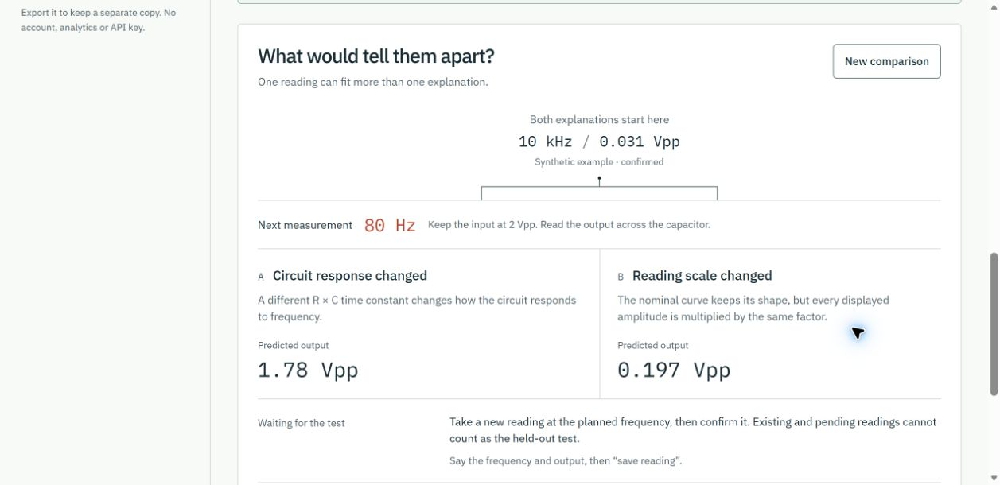

# Benchlog

A voice-led investigation for the electronics bench. Speak a reading, compare two explanations that fit it, then save their predictions before taking the test that tells them apart.

Built for the **Hiya Voice AI Challenge, Productivity track**. The supported experiment is an ideal first-order RC low-pass filter with fixed sine-wave input. Benchlog records values read by a person, with correction and explicit confirmation. It does not connect to or operate lab instruments.

- Repository: [github.com/talayahya/Benchlog](https://github.com/talayahya/Benchlog/)
- Live demo: [talayahya.github.io/Benchlog](https://talayahya.github.io/Benchlog/)
- [Watch the narrated demonstration](https://talayahya.github.io/Benchlog/demo.html): animated model explanations, real app captures, English captions and chapter navigation. All test readings and speech are labelled as synthetic.
- [Inspect the exported investigation record](docs/investigation-example.json)
- [One-page project explanation](docs/submission.md)
- [AI assistance disclosure](ai.md)
- [Research and design decisions](docs/research.md)
- [Investigation prior art and scientific limits](docs/investigation-prior-art.md)
- [Plain-language review guide](docs/review-guide.md)
- [Verification record and limits](docs/verification.md)



## Run locally

Use **Node.js 22.12 or newer** and npm. From the repository directory:

```sh
npm ci
npm run dev
```

Open the localhost address printed by Vite. No API key, paid account or backend service is required. Dependencies need an internet connection during installation. Microphone access requires a secure context, such as HTTPS or localhost.

To check the code and preview the production build:

```sh
npm test
npm run build
npm run preview
```

`npm run check` runs TypeScript checks without making a production bundle. `npm run test:watch` keeps tests running during development.

This application uses the browser WASM runtime, not native Node GPU inference. CI sets `ONNXRUNTIME_NODE_INSTALL=skip` during `npm ci` to avoid an unnecessary native-binary download. If that download fails on a local Linux setup, set the same environment variable for installation; this does not disable the browser speech runtime.

## Try the complete workflow

### From a reading to a revealing test

Choose **Try investigation** for a fresh, isolated example with the defaults **1 kΩ, 100 nF and 2 Vpp**. The values below are a **synthetic worked example**, not measurements from a physical circuit. The example keeps them separate from personal results. Its audio buttons send synthetic recordings through actual local Whisper; **Run this phrase** exercises the interpreter with text instead.

1. Say or type **“At ten kilohertz, output thirty one millivolts.”** Check the pending values, then **“Save reading.”**
2. Ask **“What would tell these apart?”** or choose **Compare explanations**. Two constrained models fit that same confirmed observation: one changes the RC time constant; the other retains the nominal curve and changes a constant amplitude scale.
3. The app compares their predictions over a disclosed finite candidate grid. For this example it proposes **80 Hz**, predicting approximately **1.78 Vpp** versus **0.197 Vpp**. The comparison command saves a **prediction receipt** with the original observation, setup, model parameters and predictions.
4. Enter **“At eighty hertz, output one point seven eight volts.”** Confirm it. The new reading is compared with the predictions already saved; neither model is refitted to the answer.
5. Open **Prediction receipt** or ask **“Review the investigation.”** This result matches the changed-time-constant example within the illustrative comparison band. It does not identify a faulty capacitor: the model sees the product of resistance and capacitance, not which one changed.
6. Export Markdown or JSON to inspect the retained evidence. Outcomes also include both models matching, neither matching and inconsistent repeated readings. **New comparison** is an explicit action that replaces the current receipt, so export first if you need to retain it separately.

The comparison uses an engineering rule, **± the larger of 5% of the prediction or 0.01 Vpp**, not a statistical confidence interval or instrument specification. It only considers new confirmed readings within 2% of the planned frequency. Existing data and pending values cannot become the held-out test.

### Capture, correct and keep the record

1. Choose **Try example** for an isolated notebook containing explicitly labelled synthetic readings. The guided phrases demonstrate capture, correction, confirmation and handling a missing unit. Your own notebook is kept separately.
2. Return to **My notebook**. The starting setup is **1 kΩ, 100 nF and 2 Vpp**. Change these with **Set up experiment** before collecting data. Keep the input amplitude fixed during this notebook.
3. Choose **Start voice session**, select a speech mode, then allow microphone access. Wait until the app says it is listening.
4. Say **“At one kilohertz, output one point seven volts.”** The reading is proposed, not yet saved. Voltages use the experiment's peak-to-peak convention, which the app reads back.
5. Say **“Correct output to one point six eight volts.”** Check the new value, then say **“Save reading.”** The confirmed reading enters the table and plot.
6. Say **“Note: the trace looks noisy.”** Notes are stored separately from numerical measurements.
7. Use **Export** to download a CSV, Markdown report or JSON record. Stop the voice session when finished.

You can use **Or type what you would say** throughout. This exercises the same command interpreter without running speech recognition. It is also a fallback when a microphone or recognition service is unavailable.

### Test actual speech recognition without a microphone

Open **How it works**, then choose **Transcribe the sample on this device**. The app feeds [`public/examples/reading.wav`](public/examples/reading.wav), a synthetic Windows text-to-speech recording, through the actual local Whisper model. It opens an isolated example notebook, downloads the model if necessary and presents the resulting transcript as a pending reading. This is real model inference on synthetic audio, rather than a prerecorded transcript substituted for recognition.

In a desktop Edge check, Whisper returned **“At 1 kilohertz, output 1.7 volts.”**, which became a pending **1000 Hz / 1.7 Vpp** reading. The guided correction to **1.68 Vpp** and subsequent confirmation added it to the notebook and plot. This checks one audio fixture, not live microphone accuracy or general recognition performance. See the [verification record](docs/verification.md).

## Supported commands

| Purpose                                          | Example                                               |
| ------------------------------------------------ | ----------------------------------------------------- |
| Propose a measurement                            | `At one kilohertz, output one point six eight volts`  |
| Use SI symbols                                   | `At 500 Hz, output 1900 mV`                           |
| Include phase                                    | `At 1000 Hz, output 1.68 Vpp, phase minus 32 degrees` |
| Correct a pending value                          | `Correct output to 1.6 volts`                         |
| Complete a partial reading                       | `Frequency two kilohertz`                             |
| Save a complete pending reading                  | `Save reading`                                        |
| Discard an unconfirmed reading                   | `Discard reading`                                     |
| Bring the last saved reading back for correction | `Undo last reading`                                   |
| Hear the current or last saved reading           | `Repeat last reading`                                 |
| Add an observation                               | `Note: the trace looks noisy`                         |
| Summarise saved records                          | `Summarise the session`                               |
| Suggest a point from the RC model                | `Suggest next frequency`                              |
| Fit two explanations and save a prospective test | `What would tell these apart?`                        |
| Review the saved comparison and its outcome      | `Review the investigation`                            |
| Explicitly replace the current comparison        | `New comparison`                                      |
| Get command help                                 | `Help`                                                |

The interpreter supports bounded English commands, not unrestricted conversation. Numerical fields need units. It distinguishes `mHz` from `MHz`, rejects RMS and peak-only readings, and does not guess a missing unit. A changed input amplitude must be made through experiment setup rather than silently mixed into the current sweep.

Once a notebook contains readings or notes, changing its setup starts a **new notebook**. Export the current one first if you want to keep it. This prevents existing gains being reinterpreted with different component or input values.

## Speech modes

| Mode              | What happens                                                                                                         | Main limitation                                                                                        |
| ----------------- | -------------------------------------------------------------------------------------------------------------------- | ------------------------------------------------------------------------------------------------------ |
| Browser speech    | A compatible browser converts speech to text and supplies results to Benchlog.                                       | Availability varies. The browser may send audio to its speech provider and usually needs a connection. |
| On-device Whisper | `onnx-community/whisper-tiny.en` runs through Transformers.js, with quantised `q8` weights and WASM in a Web Worker. | Model/runtime resources download on first use; processing time depends on the device. English only.    |
| Typed phrase      | The entered text goes directly to the same interpreter.                                                              | No speech recognition is performed.                                                                    |

For local voice, pause for roughly **1.2 seconds** after a phrase. Simple audio-level detection divides recordings into turns; it is not a sophisticated speaker or noise detector. Benchlog pauses recognition while reading a response back. Speech spoken over that reply may need to be repeated afterwards.

Local mode selects an English speech-synthesis voice that the browser reports as local (`localService === true`). If no local English voice is available, it keeps the reply on screen and continues without spoken read-back. Browser-speech mode uses the browser/operating system's available voice facilities and does not make the same local-only guarantee.

The **How it works** dialog also accepts an audio clip for local transcription. It must be a format the browser can decode, **0.1–30 seconds** long and no larger than **10 MB**. The first use downloads the model. Download size and inference latency have not been benchmarked, so no fixed figures are promised.

## Architecture

```text
Microphone / local audio file
             |
       AI speech recognition
             |
         Transcript                 Typed phrase
             |                           |
             +------------+--------------+
                          |
             Deterministic command engine
                          |
                Pending numeric reading
                          |
                 Explicit confirmation
                          |
          Saved notebook + RC plot + exports
                          |
             Two fitted explanations
                          |
           Frozen prediction receipt
                          |
             New confirmed test reading
                          |
          Compare with saved predictions
```

Speech recognition uses pretrained AI. Parsing, validation, confirmations, history, calculations and exports use conventional TypeScript. There is no general-purpose LLM deciding what a measurement should be.

| File                                | Responsibility                                                                                     |
| ----------------------------------- | -------------------------------------------------------------------------------------------------- |
| `src/engine.ts`                     | Command interpretation, unit validation, notebook transitions, RC maths and exports.               |
| `src/investigation.ts`              | Two constrained model fits, candidate selection, saved-receipt validation and held-out comparison. |
| `src/InvestigationPanel.tsx`        | Rival predictions, proposed test, comparison outcome and inspectable receipt.                      |
| `src/voice.ts`                      | Browser recognition lifecycle and spoken read-back.                                                |
| `src/localVoice.ts`                 | Microphone capture and silence-delimited local speech turns.                                       |
| `src/localSpeech.ts`                | Clip validation, decoding, mono 16kHz conversion and worker requests.                              |
| `src/whisper.worker.ts`             | Local speech model download and inference.                                                         |
| `src/storage.ts`                    | Versioned browser storage and downloadable files.                                                  |
| `src/App.tsx`                       | Application state and interaction.                                                                 |
| `src/Plot.tsx`, `src/Schematic.tsx` | The response plot and circuit diagram.                                                             |
| `tests/`                            | Automated checks of the implemented behaviour.                                                     |

## Model assumptions

The expected response is for an ideal, unloaded, first-order RC low-pass filter, with output measured across the capacitor and a sine-wave input:

```text
cutoff frequency = 1 / (2πRC)
expected gain dB = -10 × log10(1 + (frequency / cutoff)²)
recorded gain dB = 20 × log10(output Vpp / configured input Vpp)
```

With the defaults, the calculated cutoff is approximately **1.59 kHz**. The expected curve and confirmed readings remain distinct. Probe loading, source impedance, component tolerances and instrument errors are not included. A suggested next frequency comes from this model, not an analysis of an instrument waveform. Phase can be recorded as an additional value; the current response chart focuses on amplitude gain.

### Two explanations, not a fault diagnosis

The investigation fits a confirmed positive output below the configured input. Both alternatives use:

```text
output = input × scale / sqrt(1 + (2π × frequency × time constant)²)
time constant = resistance × capacitance
```

The first model fixes scale at one and fits the time constant. The second keeps the nominal time constant and fits a constant scale. Both match the anchor by construction. The proposed frequency maximises absolute voltage separation only over nine nominal-cutoff multiples, rounded to two significant figures and bounded to 1 Hz–1 MHz. Frequencies already measured within 2% are excluded. The full candidate list is retained in the JSON receipt. A separation below 1% of input is refused as unhelpful under the prototype's planning rule.

The receipt copies its source reading, configuration, fitted parameters and predictions. Changing the configuration or deleting/changing the anchor invalidates its comparison. Matching a model does not prove a physical cause, and these two alternatives are not exhaustive. The [review guide](docs/review-guide.md) works through the calculations in ordinary language; the [prior-art check](docs/investigation-prior-art.md) explains how this builds on established voice-lab and model-based troubleshooting ideas.

## Data and privacy

- Benchlog has no account system, analytics or application database.
- Your notebook is stored in this browser's local storage. Clearing browser data removes it. Export a separate copy before changing devices or starting a new experiment.
- The synthetic example uses separate application state and does not replace the personal notebook.
- Benchlog does not persist audio recordings. Confirmed transcripts, corrections and notes remain in the local record. JSON exports contain the full session, including any pending reading and prediction receipt. Markdown includes the confirmed experiment and investigation; CSV remains a confirmed-measurement table.
- Browser speech may send audio to the browser's chosen provider. This is disclosed before activation.
- Local Whisper processes captured audio on the device. Model/runtime downloads contact their hosting providers. The app fonts are bundled locally.
- Spoken read-back uses the browser's speech-synthesis facilities. Local mode explicitly selects a browser-reported local English voice or falls back to text; browser-speech mode depends on the browser/operating system's available voices.

## Verification and limits

The tests exercise the command engine and voice lifecycle, including parsing, validation, correction, confirmation, export behaviour and stale-callback handling. Investigation tests cover independently calculated predictions, frozen receipts, withheld evidence, invalidation and both/neither/inconsistent outcomes. Run `npm test` for the current result and see the dated [verification record](docs/verification.md). A successful build or mocked voice test does not establish real microphone accuracy.

The localhost production build's local Whisper path was exercised with the bundled synthetic speech fixture in desktop Microsoft Edge. The complete eight-step guided workflow produced six readings and one note. The downloaded CSV retained the original 1.7 Vpp phrase and its correction to 1.68 Vpp. A 390 × 844 browser viewport had no horizontal page overflow; this was an emulated viewport, not a physical mobile-device test. Live microphone lifecycle behaviour is covered with mocks; there has not been a live user microphone trial or a broad browser/device test. The distinction is recorded in [verification.md](docs/verification.md).

This prototype has no completed lab user study, measured time-saving claim or benchmark across accents, noise conditions and devices. It does not check electrical safety or control equipment. Its history is inspectable local provenance, not an immutable audit system. Recognition can be wrong; review each proposed reading.

Useful next work is to test the workflow with students at the bench, measure errors and interruptions against a spreadsheet baseline, and improve recovery where recognition or phrasing fails. More detail is in [research.md](docs/research.md) and the [review guide](docs/review-guide.md).

### Reproduce the video

The revised film combines actual app captures with animated circuit/model illustrations, stock SoniaNeural narration, the three synthetic input fixtures and licensed instrumental music. It is an edited explanation, not a continuous recording, instrument experiment or latency benchmark. See the [narration script](docs/video/seminar-narration.md), [timeline manifest](docs/video/seminar-manifest.json), [production research](docs/video-redesign-research.md) and [credits](docs/video/credits.md).

With Python, Pillow, imageio-ffmpeg and the Windows Segoe UI/Consolas fonts available, run `python scripts/build_seminar_video.py --frames-only` to inspect the storyboard. Then render with `python scripts/build_seminar_video.py --output public/benchlog-demo.mp4`. A short `--preview 20:50` produces a review segment. Frames are streamed to ffmpeg rather than saved as a large image sequence. The narration timing controls scene lengths, including pauses around the actual input clips. Music retains its separate CC BY 4.0 licence and attribution.

The earlier static edit and its renderer remain in the history as an iteration. The public MP4 and watch page are the revised narrated version.

## Credits

Interface and code: an AI-assisted project developed for Tala Yahya's Hiya challenge. See [ai.md](ai.md) for the full disclosure. IBM Plex Sans and IBM Plex Mono are used under the SIL Open Font License. The local speech model and dependencies retain their own licences; see their bundled or upstream licence files. Film music and synthetic narration are separately credited in [video credits](docs/video/credits.md).
